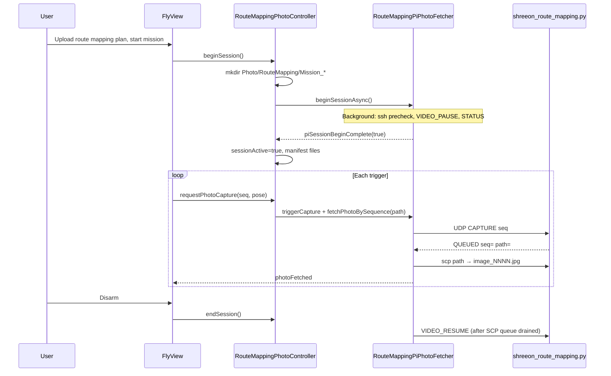

# Shreeon Route Mapping — end-to-end implementation guide

This document describes the **Route Mapping** feature in this QGroundControl fork: mission planning, fly-view photo progress, Raspberry Pi full-resolution capture, and GCS geotagged JPEG transfer. It reflects the implementation as of the current tree (Pi script + QGC Fly View).

For Pi-only install notes, see also [`deploy/pi-route-mapping/README.md`](../../deploy/pi-route-mapping/README.md).

---

## 1. What Route Mapping does

1. Operator draws or imports a **survey pattern** in Route Mapping mode and uploads it to the vehicle.
2. In **Fly View**, the transect overlay shows progress; each photo trigger creates a **map tile** (when the JPEG arrives).
3. **Full-resolution stills** (4608×2592) are taken on the **Pi** via `rpicam-still`, not from the H.264 downlink.
4. The **GCS** writes **geotag JSON** and copies each JPEG from the Pi with **SCP** into a local mission folder for reconstruction / backfill.

Two separate storage locations exist by design:

| Side | Root path | Session folder | Per shot |
|------|-----------|----------------|----------|
| **Pi** | `/home/shreeon/mapping_photos` | `mission_YYYYMMDD_HHMMSS/` | `image_NNNN_gcs_NNNN_<timestamp>.jpg` |
| **GCS** | `<App save path>/Photo/RouteMapping` | `Mission_<UTC>_<uuid>/` | `image_NNNN.jpg` + `image_NNNN.json` |

Daily build example on GCS:

```text
~/Documents/QGroundControl Daily/Photo/RouteMapping/Mission_20260919_075355_504_<uuid>/
```

Quote paths that contain spaces:

```bash
ls "$HOME/Documents/QGroundControl Daily/Photo/RouteMapping"/Mission_*
find "$HOME" -type f -path '*/RouteMapping/*/image_*.json' 2>/dev/null
```

---

## 2. Architecture

```text
┌─────────────────────────────────────────────────────────────────┐
│  QGC — Plan: RouteMappingView.qml, RouteMappingTaskSettings.qml │
│         Survey params → cameraShots (N), trigger distance, legs  │
└────────────────────────────┬────────────────────────────────────┘
                             │ overlay + planned photo count N
┌────────────────────────────▼────────────────────────────────────┐
│  QGC — Fly View (source of truth for when to shoot)              │
│         Precompute N trigger distances along photo-capture legs    │
│         Vehicle progress → CAPTURE 1..N (no MAVLink camera API)  │
│         RouteMappingPhotoController + RouteMappingPiPhotoFetcher │
└───────────────┬───────────────────────────────┬───────────────┘
                │ UDP :14551                      │ SSH/SCP :22
                │ VIDEO_PAUSE, CAPTURE seq, STATUS│
┌───────────────▼───────────────────────────────▼───────────────┐
│  Pi: shreeon_route_mapping.py — one still per CAPTURE seq only   │
│      QGC_LED=1 disables UART auto-trigger; rpicam-still          │
└─────────────────────────────────────────────────────────────────┘
                │ PX4 flies uploaded survey mission (position only)
┌───────────────▼─────────────────────────────────────────────────┐
│  Autopilot — mission waypoints / speed; not photo count authority │
└─────────────────────────────────────────────────────────────────┘
```

### Key source files

| Area | Files |
|------|--------|
| Plan UI | `src/QmlControls/RouteMappingView.qml`, `RouteMappingTaskSettings.qml` |
| Fly View | `src/FlyView/FlyView.qml`, `FlyViewMap.qml`, `FlyViewMappingProgressPanel.qml` |
| GCS photos | `src/FlyView/RouteMappingPhotoController.{h,cc}` |
| Pi link | `src/FlyView/RouteMappingPiPhotoFetcher.{h,cc}` |
| Pi daemon | `deploy/pi-route-mapping/shreeon_route_mapping.py` |
| Pi deploy | `deploy/pi-route-mapping/install-on-pi.sh`, `route-mapping-capture.service` |
| Demo plan | `demo/BaylandsRouteMapping.plan` |

### Fly View flags (`FlyView.qml`)

- `routeMappingPhotoProgressEnabled` — true when `uploadedMissionEditor === "routeMapping"`.
- `routeMappingPiPhotoFetchEnabled` — same; enables Pi SSH/UDP path (not video frame grab).
- Defaults: Pi host `10.5.0.2`, user `shreeon`, photo root `/home/shreeon/mapping_photos`, UDP port `14551`.

---

## 3. Operator workflow (step by step)

### 3.1 Before flight

**On the GCS**

1. Build/install this QGC fork.
2. Install SSH key on the Pi (non-interactive SCP required):

   ```bash
   ssh-copy-id shreeon@10.5.0.2
   ssh -o BatchMode=yes -o ConnectTimeout=8 shreeon@10.5.0.2 true
   ```

3. Confirm WFB/link so `10.5.0.2` is reachable when the vehicle is powered.

**On the Pi**

1. Deploy the capture service from this repo (on the Pi):

   ```bash
   cd deploy/pi-route-mapping
   sudo bash install-on-pi.sh
   ```

2. In `/etc/default/shreeon-route-mapping`, set `MANUAL_HOST=0.0.0.0` so GCS can send UDP to port **14551**.
3. Verify:

   ```bash
   systemctl status route-mapping-capture.service
   printf 'VIDEO_PAUSE' | nc -u -w 5 127.0.0.1 14551
   sleep 3
   printf 'STATUS\n' | nc -u -w 2 127.0.0.1 14551
   ```

   Expected (current script): `OK session=/home/shreeon/mapping_photos/mission_…`  
   Legacy Pi may reply bare `OK`; QGC falls back to `STATUS` (see §5).

### 3.2 Plan and upload

1. Open **Route Mapping** from the mode selector.
2. Import or draw the survey (e.g. `demo/BaylandsRouteMapping.plan`).
3. Set pattern altitude, speed, and photo settings in the task panel.
4. **Upload** the mission to the vehicle.
5. Return to **Fly View** — transect overlay and photo count (e.g. 0 / N) appear when route-mapping mode is active.

### 3.3 Mission and photos

1. **Arm** — live photo model resets; Pi session is **not** started on arm (avoids blocking UI).
2. **Start mission** (or first photo trigger) — GCS creates local `Mission_*` folder; Pi session starts **in a background thread** (SSH precheck + `VIDEO_PAUSE` + `STATUS` if needed).
3. **QGC** (not MAVLink camera protocol) decides when to shoot:
   - On plan upload, survey **`cameraShots`** (N) and **trigger distance** define the schedule.
   - Fly View precomputes **N distances** along interior photo-capture legs (same math as `SurveyComplexItem`).
   - As the vehicle progresses along those legs, GCS fires **Photo 1 … Photo N** (max **N**; no extra Pi shots).
   - For each trigger: write `image_NNNN.json`, UDP **`CAPTURE N`**, Pi still, **SCP** → `image_NNNN.jpg`.
   - Map tile and Photos count update only when `photoFetched` succeeds.
   - Pi **`QGC_LED=1`**: UART `CAMERA_TRIGGER` does not add captures during a QGC session.
4. **Disarm** — GCS stops accepting new triggers, drains all capture and SCP
   queues, then sends `VIDEO_RESUME` when the fetch queue is empty.

### 3.4 After flight

- **GCS photos:** `Photo/RouteMapping/Mission_*` and `latest_mission_session.txt` under `Photo/RouteMapping/`.
- **Pi photos:** `/home/shreeon/mapping_photos/mission_*`.
- Match shots by sequence number and timestamps in JSON sidecars.

---

## 4. Pi UDP protocol (manual port 14551)

Commands are plain UTF-8 text datagrams (newline optional).

| Command | Pi action | Reply (current script) |
|---------|-----------|-------------------------|
| `VIDEO_PAUSE` | New `mission_*` dir, stop `wfb-camera`, ~2 s sensor release | `OK session=/home/shreeon/mapping_photos/mission_…` |
| `CAPTURE N` | Queue still; path fixed at queue time | `QUEUED seq=N path=/full/path/to/image_….jpg` |
| `STATUS` | Report active session | `SESSION /path` or `SESSION NONE` |
| `VIDEO_RESUME` | Restart camera, close session | `OK` |

Duplicate `CAPTURE N` in the same Pi session is **idempotent** (same path returned, no second file).

GCS tests from the field laptop:

```bash
printf 'VIDEO_PAUSE' | nc -u -w 5 10.5.0.2 14551
printf 'STATUS\n'    | nc -u -w 2 10.5.0.2 14551
printf 'CAPTURE 1'   | nc -u -w 2 10.5.0.2 14551
```

---

## 5. QGC implementation details

### 5.1 `RouteMappingPhotoController`

- Resolves GCS root: `AppSettings::photoSavePath()` + `/RouteMapping`.
- **`beginSession()`** — creates `Mission_<UTC>_<uuid>/` on disk, then calls **`beginSessionAsync()`** on the fetcher (Pi work off UI thread).
- Sets **`sessionActive`** only after Pi session succeeds (`piSessionBeginComplete`).
- **`requestPhotoCapture()`** — writes JSON, `triggerCapture()`, enqueues SCP via `fetchPhotoBySequence(..., remotePath)`.
- **Discoverability (Bug 5):**
  - `RouteMapping/README.txt` (once)
  - `RouteMapping/latest_mission_session.txt` (updated each session)
  - `Mission_*/session_manifest.json` (paths and timestamps)
  - Log category: `FlyView.RouteMappingPhotoController`

### 5.2 `RouteMappingPiPhotoFetcher`

**Session start (async)**

1. `resetSession()` / generation counter.
2. Background thread: `ssh BatchMode=yes user@host true` (precheck, retried); **skip `VIDEO_PAUSE` if SSH fails**.
3. UDP `VIDEO_PAUSE`; wait for `OK session=…` **or** after settle (~2.5 s) query `STATUS` with retries.
4. Validate path under configured `piPhotoRoot`.
5. Main thread: emit `sshPrecheckFailed`, `sessionStartFailed`, or `piSessionBeginComplete(true)`.

**Per photo**

1. **`triggerCapture(seq)`** — synchronous UDP `CAPTURE seq`; parse `QUEUED seq= path=`.
2. **`fetchPhotoBySequence`** — if `remotePhotoPath` set, **SCP that path only**; else legacy **find** scoped to **`piSessionPath`** (never global `mapping_photos`).
3. Retries: up to 120 attempts, 2 s apart; re-send `CAPTURE` every 5th attempt.

**Session end**

- `finishSession()` stops new captures; `fetchQueueDrained` → Fly View calls `resumeLiveVideo()` (`VIDEO_RESUME`).

**Logging:** `FlyView.RouteMappingPiPhotoFetcher`

### 5.3 Fly View integration

- Photo session starts on **`missionRunning`** or first capture path, **not on arm**.
- Errors: modals via `mainWindow.showMessageDialog` (do **not** use `qgcApp()` in QML — C++ only).
- Successful session path: **`console.info`** with `[RouteMapping]` when `sessionActive` becomes true.

---

## 6. Bug fixes and behavior changes (changelog)

| ID | Problem | Fix |
|----|---------|-----|
| **Bug 3** | Global `find … image_NNNN_* \| tail -1` could pick JPEG from another mission | Pi: planned path in `QUEUED seq=N path=…`; GCS: SCP exact path; fallback find only under session dir |
| **Bug 5** | Could not find GCS `Mission_*` folders | Locator files, README under RouteMapping, logging, `photoSaveRoot` / `routeMappingRoot` properties |
| SSH | `Unknown error` / precheck always failed | `QProcess::start()` was missing in `runProcess()` |
| SSH UI | Dialog always said “install ssh-copy-id” | Show real `ssh` stderr + link/WFB hints |
| UDP | `Unexpected VIDEO_PAUSE response: OK` | Ignore stale bare `OK`; wait for `session=` or STATUS after camera settle |
| UDP | `Timed out waiting for STATUS` | Retries, multi-packet read, delay before STATUS after VIDEO_PAUSE |
| UI freeze | GUI blocked 12s+ on SSH/UDP | `beginSessionAsync()` via `QtConcurrent`; no session start on arm; removed blocking “photos save here” modal |
| QML | `ReferenceError: qgcApp is not defined` | Replaced with `mainWindow.showMessageDialog` / console.info |
| Build | `'findRoot' is not captured` | Lambda capture in `_listRemotePhotos` |

---

## 7. Sequence diagram (current behavior)



---

## 8. Troubleshooting

| Symptom | Likely cause | Action |
|---------|--------------|--------|
| SSH modal / precheck failed | No key, link down, wrong IP | `ssh-copy-id`, ping `10.5.0.2`, fix WFB |
| Pi session failed / STATUS timeout | Link flap, old Pi script, camera stop slow | Deploy latest `shreeon_route_mapping.py`; test `nc` with 3 s delay before STATUS |
| 0 / N photos forever | Session never became active, or capture disabled | Check logs; ensure mission running and transect overlay uploaded |
| Wrong JPEG geotag | Old global find (pre-fix build) | Upgrade QGC; use path-based SCP |
| QGC “not responding” | Old build blocking GUI on session start | Rebuild with async `beginSessionAsync` |
| Empty GCS folder | `photoSavePath` / save root empty | Application settings save path; see `RouteMapping/README.txt` |

**Log filters (Qt logging):**

```text
FlyView.RouteMappingPiPhotoFetcher
FlyView.RouteMappingPhotoController
```

---

## 9. Deployment checklist

- [ ] GCS: QGC built from this repo installed.
- [ ] GCS: `ssh-copy-id shreeon@10.5.0.2` succeeds with BatchMode.
- [ ] Pi: `sudo bash install-on-pi.sh` from `deploy/pi-route-mapping`.
- [ ] Pi: `VIDEO_PAUSE` returns `OK session=…` (upgrade if only `OK`).
- [ ] Pi: `CAPTURE 1` returns `QUEUED seq=1 path=…`.
- [ ] Link: UDP and SSH to `10.5.0.2` stable during mission.
- [ ] Mission: Route mapping plan uploaded; Fly View shows transect and photo total N.

---

## 10. Known limitations

- **`triggerCapture`** still uses a **synchronous UDP wait** on the GUI thread per shot (up to ~8 s timeout). Session start is async; per-shot UDP could be moved to a worker in a follow-up.
- **JSON metadata** does not yet include `state=requested/fetched/failed` (only trigger fields).
- **GCS and Pi session folder names** differ by design; correlation is by sequence + path + timestamps.
- **Mixed versions:** New QGC + old Pi works via STATUS + session-scoped find; full path protocol needs Pi script deploy from §3.1.

---

## 11. Related demo

- Import `demo/BaylandsRouteMapping.plan` in Route Mapping for a sample survey.
